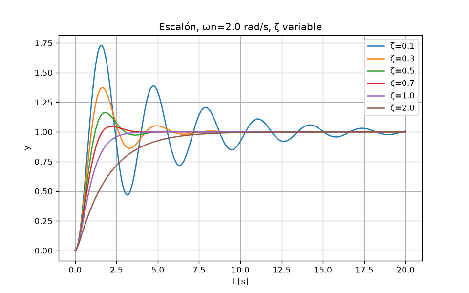
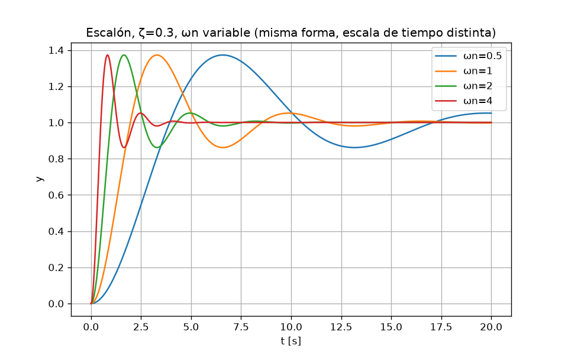
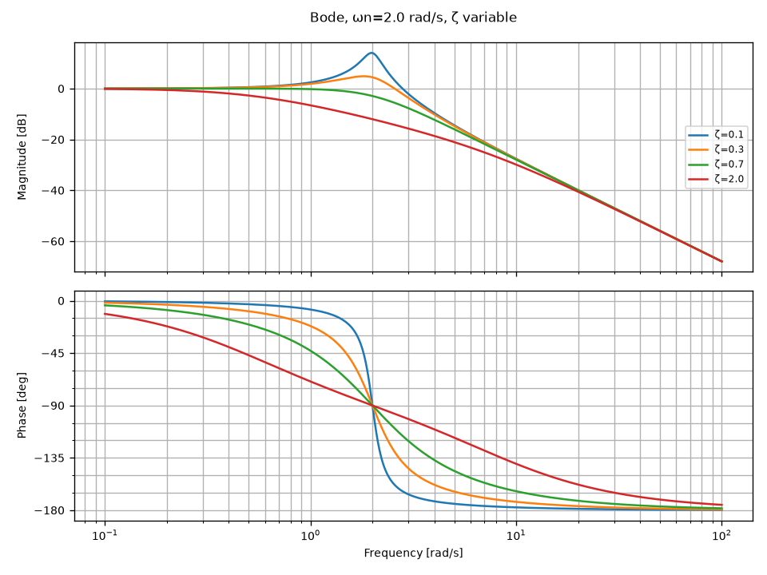
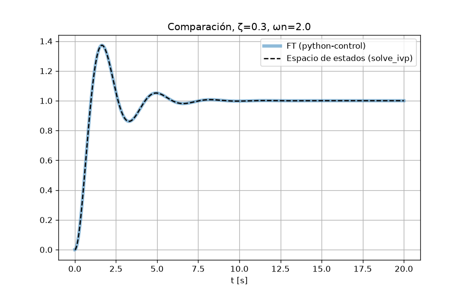

# Lección 1 — Sistema de segundo orden

## Concepto
- **Estado**: mínimo conjunto de variables que, junto con la entrada, determina la evolución futura. Aquí `x1 = y` (posición), `x2 = ẏ` (velocidad).
- **EDO**: `ÿ + 2ζωn ẏ + ωn² y = ωn² u`.
- **Función de transferencia** (Laplace, condiciones iniciales nulas): `G(s) = ωn² / (s² + 2ζωn s + ωn²)`. Ganancia estática G(0)=1.
- **Polos**: raíces del denominador, `s = -ζωn ± ωn√(ζ²-1)`. Parte real → velocidad de decaimiento; parte imaginaria → frecuencia de oscilación (`ωd = ωn√(1-ζ²)`).
- **ζ (amortiguamiento)**: forma de la respuesta. ζ<1 subamortiguado (polos complejos, oscila), ζ=1 crítico (polo doble real), ζ>1 sobreamortiguado (dos polos reales, uno lento).
- **ωn (frecuencia natural)**: escala de tiempo. Con ζ fija, duplicar ωn hace la respuesta el doble de rápida, misma forma.

Fórmulas: `Mp = exp(-ζπ/√(1-ζ²))`, `ts(2 %) ≈ 4/(ζωn)`.

## Qué hace `segundo_orden.py`
1. `G(zeta, wn)`: crea la FT con `control.tf`.
2. Escalón con ωn=2 y ζ ∈ {0.1, 0.3, 0.5, 0.7, 1, 2} → `escalon_zeta.png`.
3. Escalón con ζ=0.3 y ωn ∈ {0.5, 1, 2, 4} → `escalon_wn.png`.
4. `control.step_info` (Mp, tr 10–90 %, ts 2 %) frente a fórmulas, más los polos.
5. Bode para ζ ∈ {0.1, 0.3, 0.7, 2} → `bode_zeta.png`.
6. Mismo sistema en espacio de estados integrado con `scipy.integrate.solve_ivp` y superpuesto a la FT → `comparacion_ss_tf.png`.

Ejecutar: `python3 segundo_orden.py`

## Resultados (ωn = 2 rad/s)
| ζ | Mp num % | Mp teórico % | tr [s] | ts num [s] | 4/(ζωn) [s] | polos |
|---|---|---|---|---|---|---|
| 0.1 | 72.92 | 72.92 | 0.555 | 19.20 | 20.00 | -0.2 ± 1.99j |
| 0.3 | 37.23 | 37.23 | 0.660 | 5.62 | 6.67 | -0.6 ± 1.91j |
| 0.5 | 16.30 | 16.30 | 0.820 | 4.04 | 4.00 | -1.0 ± 1.73j |
| 0.7 | 4.60 | 4.60 | 1.065 | 2.99 | 2.86 | -1.4 ± 1.43j |
| 1.0 | 0 | 0 | 1.675 | 2.92 | 2.00 | -2, -2 |
| 2.0 | 0 | 0 | 4.111 | 7.44 | 1.00 | -7.46, -0.54 |

Lectura:
- Mp coincide exactamente: la fórmula es exacta.
- `ts ≈ 4/(ζωn)` es una cota de la envolvente: buena aproximación para ζ≲0.7, **no vale** para ζ≥1 (para ζ=2 domina el polo lento −0.54 → ts ≈ 4/0.54 ≈ 7.4 s).
- FT vs `solve_ivp` (ζ=0.3): error máximo 4·10⁻¹⁰ → las dos formulaciones son el mismo sistema.
- Bode: pico de resonancia cerca de ωn para ζ pequeño (≈ +14 dB con ζ=0.1); fase −90° en ω=ωn para todo ζ; pendiente −40 dB/década a alta frecuencia.

   

## Para predecir antes de la lección 2
1. ¿Qué pasa con la respuesta al escalón si ζ = −0.2? ¿Dónde quedan los polos en el plano s?
2. Con ζ = 0, ¿dónde están los polos y cómo es la respuesta? ¿Qué valor tiene el pico de Bode?
3. Si quieres ts más corto sin cambiar Mp, ¿qué parámetro tocas y cómo se mueven los polos?
