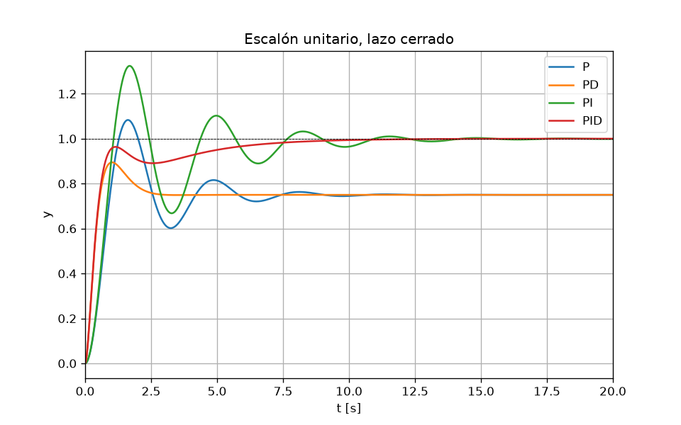
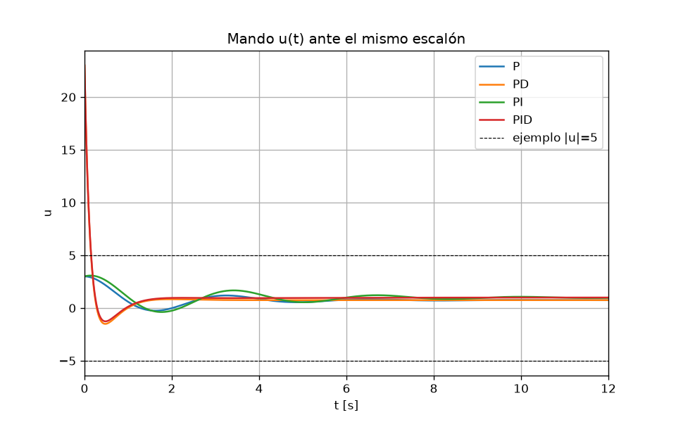
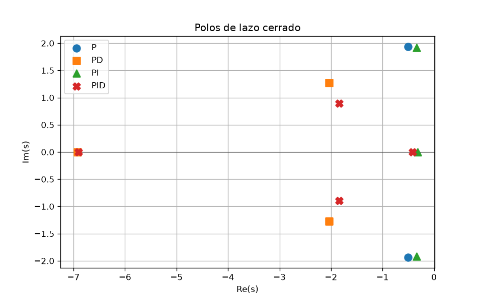
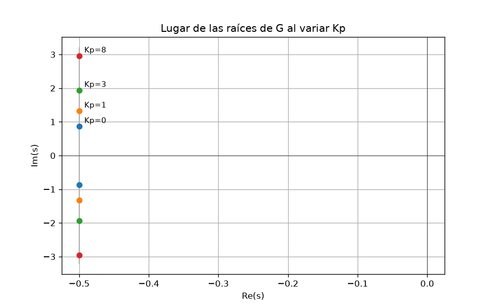

# Lección 2 — Control PID

## Concepto

Planta: un cabeceo reducido, el ángulo $\theta$ frente a la deflexión de mando $\delta$,

$$G(s)=\frac{\theta(s)}{\delta(s)}=\frac{1}{s^2+s+1}.$$

En lazo abierto es el segundo orden de la [lección 1](../01-control-segundo-orden/), con $\omega_n=1$ y $\zeta=0.5$. Es el corto periodo cuando el integrador cinemático $\dot\theta=q$ ya no está suelto, por ejemplo porque un lazo interno de velocidad angular lo ha cerrado. $G(0)=1$ es finita. Con $1/(s(s+1))$ la planta sería de tipo 1 y el error de escalón se anularía sin integrador: aquí se deja un tipo 0 para ver qué hace cada término.

Controlador, con la derivada filtrada para que un escalón no pida un impulso:

$$C(s)=K_p+\frac{K_i}{s}+K_d\frac{N s}{s+N}, \qquad N=10.$$

Si una ganancia es cero, ese término no está. Realimentación negativa unitaria. Los cuatro casos comparten $K_p=3$; PD y PID añaden $K_d=2$; PI y PID añaden $K_i=1.2$.

Con solo P el lazo cerrado sigue siendo de segundo orden, y valen las lecturas de la lección 1:

$$T_P(s)=\frac{K_p}{s^2+s+(1+K_p)}, \qquad \omega_n=\sqrt{1+K_p}, \qquad \zeta=\frac{1}{2\sqrt{1+K_p}}.$$

El error en régimen permanente ante un escalón sale del teorema del valor final, $e_{ss}=\lim_{s\to 0} 1/(1+C(s)G(s))$:

$$e_{ss}=\frac{1}{1+K_p} \quad \text{si } C(0) \text{ es finito}.$$

Con $K_i>0$, $C(s)$ tiene un polo en el origen, $C(0)$ es infinito y $e_{ss}=0$. El integrador acumula cualquier error constante y el equilibrio solo es posible si ese error es nulo.

La D no cambia $C(0)$, así que no toca $e_{ss}$. Sí sube el coeficiente de $s$ del polinomio característico, el mismo $2\zeta\omega_n$ de la lección 1, y los polos se mueven a la izquierda.

## Qué hace [pid.py](pid.py)

1. Construye P, PD, PI y PID con `control.tf` y cierra el lazo con `control.feedback`.
2. Escalón de la salida para los cuatro controladores.
3. Mando $u(t)$ del mismo escalón, con una raya en $|u|=5$ como ejemplo de saturación (no es un límite del modelo).
4. Mapa de polos de lazo cerrado.
5. Lugar de las raíces de $G$ al variar solo $K_p$. En esta planta es la vertical $\mathrm{Re}(s)=-1/2$.
6. Tabla de $M_p$, $t_r$, $t_s$, $e_{ss}$ y pico de $|u|$. $M_p$, $t_r$ y $t_s$ salen de `control.step_info` (subida del 10 % al 90 % del valor final, establecimiento en la banda del 2 % de ese valor final). $e_{ss}=1-T(0)$.

Desde la raíz del repositorio:

```bash
uv run python 02-control-pid/pid.py
```

## Resultados

Con $K_p=3$ las fórmulas de P dan $\omega_n=2$, $\zeta=0.25$ y $e_{ss}=0.25$. El par complejo de los otros tres casos es el dominante; el polo real cercano a $-7$ es el filtro de la derivada.

| Control | $M_p$ [%] | $t_r$ [s] | $t_s$ [s] | $e_{ss}$ | $|u|_{\max}$ |
| --- | --- | --- | --- | --- | --- |
| P | 44.43 | 0.630 | 7.061 | 0.2500 | 3.000 |
| PD | 19.30 | 0.395 | 2.335 | 0.2500 | 23.000 |
| PI | 32.40 | 0.720 | 10.481 | 0 | 3.081 |
| PID | 0.00 | 0.660 | 7.191 | 0 | 23.000 |

Lectura:

- P deja $y(\infty)=0.75$. Los polos están en $-0.5 \pm 1.94j$, sobre la vertical del lugar de las raíces. Subir $K_p$ sube $\omega_n$ y baja $\zeta$: la parte real no se mueve. La lección 1 ya decía que $M_p$ depende de $\zeta$, así que el proporcional paga la rapidez con más sobreoscilación.
- PD lleva el par dominante a $\zeta \approx 0.85$ y $\omega_n \approx 2.40$. $e_{ss}$ no cambia. La D es la que amortigua.
- PI anula $e_{ss}$ y baja el $\zeta$ dominante a $\approx 0.18$. Aparece un polo real en $-0.32$, y $t_s$ empeora.
- PID recupera $\zeta \approx 0.90$ con $e_{ss}=0$. Sigue el polo lento del integrador, en $-0.42$, así que $t_s$ no baja al de PD.
- El pico de $|u|$ en P y PI es del orden de $K_p$. En PD y PID, $u(0)=K_p+K_d N=23$: el filtro convierte el escalón del error en un pulso de altura $N$. Si el mando saturase en $|u|=5$, ese pulso se recorta y el amortiguamiento lineal no llega a la planta.









## Para predecir antes de la lección 3

1. Con solo P, pasas de $K_p=3$ a $K_p=8$. Calcula $\omega_n$, $\zeta$ y $e_{ss}$ con las fórmulas del lazo cerrado, sin simular. ¿Hacia dónde se mueven los polos, y por qué no puedes subir $\omega_n$ sin bajar $\zeta$?
2. El actuador no puede pasar de $|u|=5$. En PD y PID el pico lineal vale 23. ¿Qué parte de la respuesta de la tabla deja de ser válida, y en qué se parecerán esos dos casos a P y a PI?
3. La referencia pasa a ser la rampa $r(t)=t$ (un cabeceo que crece a ritmo constante). La planta es de tipo 0. ¿Qué controladores dejan un error que crece sin límite, cuál lo deja acotado, y de qué ganancia depende el error que queda?
