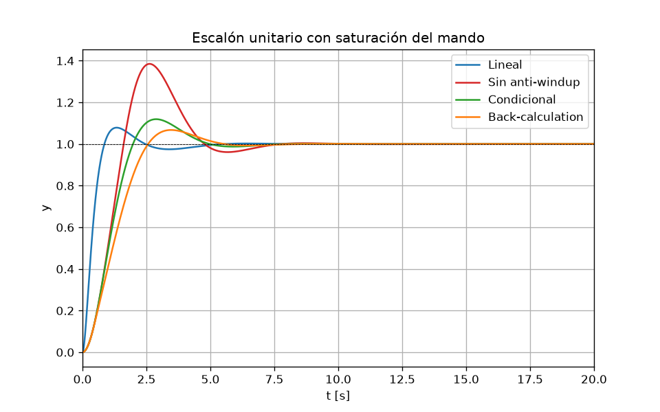
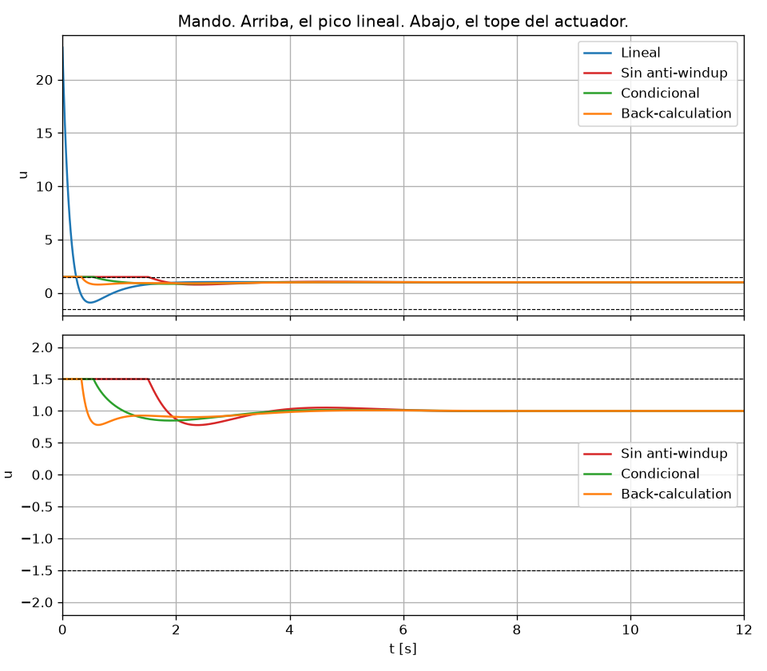
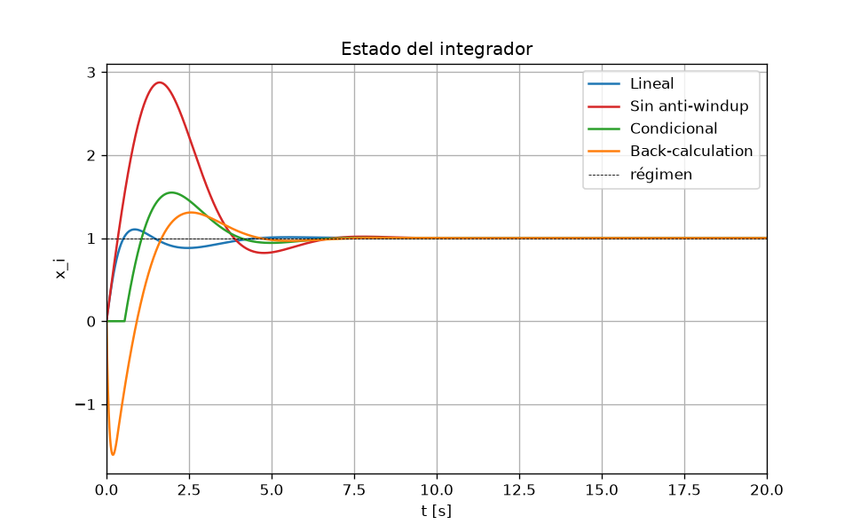
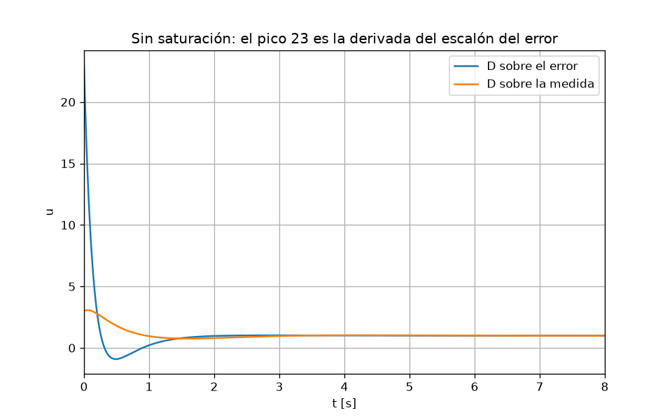

# Lección 3 — Saturación y anti-windup

## Concepto

La planta es la de la [lección 2](../02-control-pid/):

$$G(s)=\frac{1}{s^2+s+1}.$$

En lazo abierto, $\omega_n=1$ y $\zeta=0.5$. $G(0)=1$, así que el mando de régimen ante un escalón unitario vale 1. El PID lineal de la lección 2 pide en $t=0$ un pico $K_p+K_d N=23$, que un actuador real no puede dar. python-control cierra un lazo lineal: la saturación hay que imponerla en el tiempo.

$$u_{\mathrm{raw}}=K_p e+x_i+D, \qquad u=\mathrm{sat}(u_{\mathrm{raw}}), \qquad \lvert u\rvert\le u_{\max}.$$

La derivada va filtrada, como en la lección 2. Sobre el error, $D$ actúa en $e=r-y$. Sobre la medida, actúa en $-y$ y no ve el escalón de la referencia:

$$D(s)=K_d\frac{N s}{s+N}E(s) \quad\text{o}\quad D(s)=-K_d\frac{N s}{s+N}Y(s).$$

Ganancias: $K_p=3$, $K_d=2$ y $N=10$, las del pico 23. $K_i$ pasa de 1.2 a 3. Con 1.2 el tope solo dura un instante y el integrador casi no se embala. $u_{\max}=1.5$: por encima del régimen, que es 1, y muy por debajo de 23.

Sin anti-windup, $\dot x_i=K_i e$ también con el mando pegado al tope. El estado $x_i$ crece por encima del régimen y, al cruzar la referencia, el actuador sigue saturado. Eso es el windup: sobrepico grande y $t_s$ largo.

La integración condicional congela $x_i$ cuando el mando está en el tope y $e$ empuja en el mismo sentido. Si el error ya tira hacia dentro, el integrador sigue. El clamping estricto lo congelaría siempre que hubiera saturación; aquí se usa la versión condicional.

La back-calculation hace que $x_i$ persiga el mando que de verdad sale del actuador:

$$\dot x_i=K_i e+\frac{u-u_{\mathrm{raw}}}{T_t}, \qquad T_t=0.8.$$

$T_t=0.8$ s es del orden de $\sqrt{T_i T_d}$, con $T_i=K_p/K_i=1$ y $T_d=K_d/K_p=2/3$. Fuera de saturación, $u=u_{\mathrm{raw}}$ y el término de seguimiento se anula.

## Qué hace [antiwindup.py](antiwindup.py)

1. Integra la planta y el PID con RK4 a paso fijo. El recorte del mando va dentro del bucle, no en una función de transferencia.
2. Compara cuatro casos, todos con la derivada sobre el error: PID lineal, saturado sin anti-windup, saturado con integración condicional y saturado con back-calculation.
3. Dibuja $y(t)$, $u(t)$ y el estado del integrador.
4. Repite el PID lineal con la derivada sobre la medida, para quitar el pico 23.
5. Comprueba en una rampa lineal que $e_{ss}=1/K_i$.

Desde la raíz del repositorio:

```bash
uv run python 03-saturacion-antiwindup/antiwindup.py
```

## Resultados

$M_p$ es la sobreoscilación respecto del valor final. $t_s$ es el establecimiento en la banda del 2 %. $t_{\mathrm{sat}}$ es el tiempo en el que el mando pedido queda fuera del tope. En el caso lineal no hay tope, así que ese tiempo es cero aunque el pico valga 23.

| Caso | $M_p$ [%] | $t_s$ [s] | $\lvert u\rvert_{\max}$ | $t_{\mathrm{sat}}$ [s] |
| --- | --- | --- | --- | --- |
| Lineal | 7.87 | 3.984 | 23.000 | 0 |
| Sin anti-windup | 38.50 | 6.691 | 1.500 | 1.506 |
| Condicional | 11.93 | 4.513 | 1.500 | 0.547 |
| Back-calculation | 6.75 | 4.842 | 1.500 | 0.334 |

Lectura:

- Sin anti-windup el integrador sube hasta 2.88, por encima del régimen 1. La salida llega a 1.38 y $t_{\mathrm{sat}}$ pasa de 1.5 s.
- La integración condicional lo deja en 1.55. El sobrepico baja al 12 % y el tope dura 0.55 s.
- La back-calculation lo lleva un momento hasta $-1.61$ mientras el actuador está clavado, y el sobrepico queda en el 6.8 %, por debajo incluso del lineal. El término de seguimiento vacía el integrador antes de que la salida cruce la referencia.
- Ninguno de los dos anti-windup devuelve el $t_s$ lineal de 3.98 s: el actuador no puede dar el pico 23. Lo que sí quitan es el sobrepico del windup.









Con la derivada sobre el error, $u(0)=23$. Con la derivada sobre la medida, $u(0)=K_p=3$ y el pico se queda en 3.07: el escalón de la referencia ya no entra en la derivada. El enlace con la lección 2 es directo. Allí ese 23 era el pico de PD y de PID.

## Respuestas de la lección 2

Con solo P, $e_{ss}=1/(1+K_p)$. De $K_p=3$ a $K_p=8$ el error pasa de $1/4$ a $1/9$: baja al subir la ganancia. No es un error fijo. Los polos se mueven en vertical, con parte real $-1/2$. $\omega_n=\sqrt{1+K_p}$ y $\zeta=1/(2\sqrt{1+K_p})$, así que al subir $K_p$ sube $\omega_n$ y baja $\zeta$.

Si el actuador no pasa de 5, el pico lineal 23 no entra en la planta. La D deja de aportar el amortiguamiento del cálculo lineal. Esta lección es esa saturación, con un tope más bajo para que el windup se vea.

En la rampa $r(t)=t$ la planta es de tipo 0. P y PD, con $C(0)$ finito, dejan un error que crece. PI y PID lo acotan. El integrador tiene que generar el mando que crece como $t$, y su ritmo es $K_i e$, así que

$$e_{ss}=\frac{1}{K_i}.$$

Hace falta $G(0)=1$, que aquí se cumple. Con el $K_i=1.2$ de la lección 2 el error de rampa vale $1/1.2$. Con el $K_i=3$ de esta lección vale $1/3$. El PID lineal de [antiwindup.py](antiwindup.py), en $t=60$ s, da $e=0.3333$.

## Para predecir antes de la lección 4

1. Si haces $T_t$ muy grande, la back-calculation casi se apaga. Si lo haces muy pequeño, el integrador persigue el mando saturado y se vacía enseguida. ¿Cuál de los dos límites recupera el sobrepico del PID saturado sin anti-windup, y cuál se parece a la integración condicional?
2. Si bajas $u_{\max}$ hasta quedar solo un poco por encima del mando de régimen, que vale 1 porque $G(0)=1$, el anti-windup sigue anulando el windup. ¿Puede entonces recuperar el $t_s$ del PID lineal? ¿Qué es lo que sí recupera?
3. Misma saturación y misma back-calculation, pero la derivada pasa del error a la medida. ¿Cambia $e_{ss}$ del escalón? El pico del integrador, ¿sube o baja respecto de la derivada sobre el error, y por qué?
