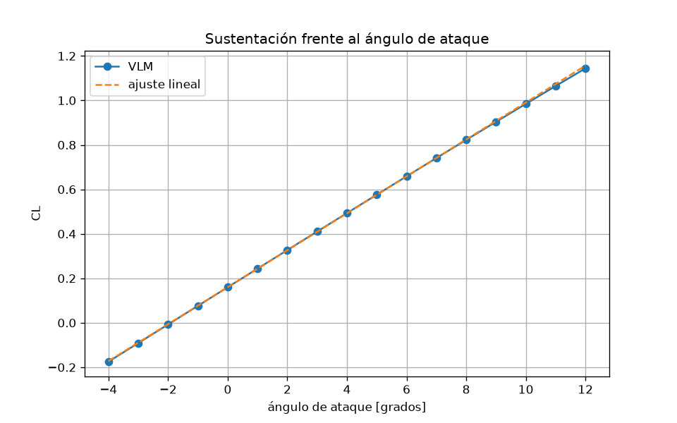
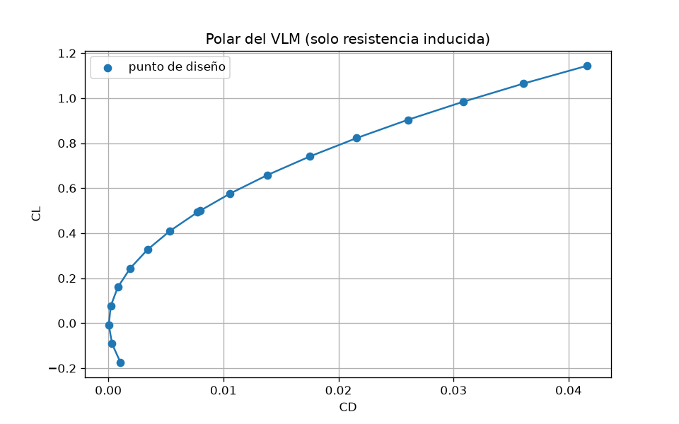
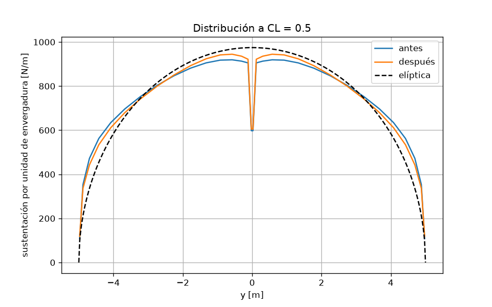
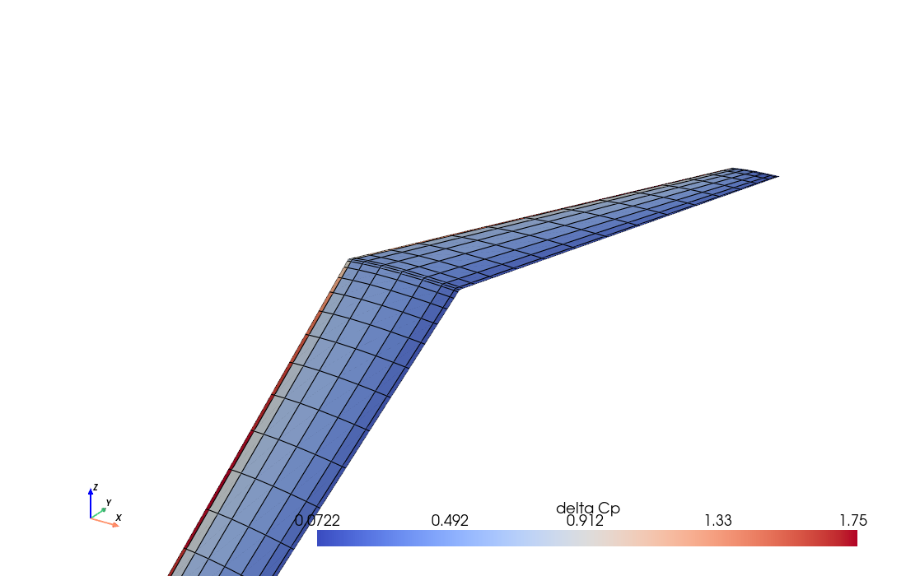

# Ala en flecha: VLM, optimización y vista 3D

Ala trapezoidal con flecha y perfil NACA 2412. El cálculo es un vortex lattice de [AeroSandbox](https://github.com/peterdalle/AeroSandbox) (`asb.VortexLatticeMethod`). La resistencia que sale es inducida: no hay capa límite. La vista 3D es [PyVista](https://docs.pyvista.org/), sin ventana.

La página con las figuras y la malla interactiva es [index.html](index.html). El código es [ala.py](ala.py).

Desde la raíz del repositorio:

```bash
uv run python demos/01-ala-aerosandbox-pyvista/ala.py
```

## Geometría

Envergadura $b=10$ m y superficie $S=10$ m$^2$, así que $\mathrm{AR}=b^2/S=10$. Flecha del borde de ataque: 25 grados. Perfil `naca2412`. El estrechamiento $\lambda=c_{\mathrm{punta}}/c_{\mathrm{raiz}}$ reparte la cuerda sin cambiar $b$ ni $S$. La torsión es nula en la raíz y lineal hasta la punta. Velocidad 50 m/s.

## Sustentación

Barrido de ángulo de ataque de $-4$ a $12$ grados, con 16 paneles en envergadura y 8 en cuerda. Entre $-2$ y $8$ grados la pendiente ajustada es

$$C_{L\alpha}=0.0831$$

por grado, o $4.76$ por radián. El término independiente del ajuste es $C_L(0)=0.160$, la sustentación de la curvatura del perfil.





## Distribución y optimización

A $C_L=0.5$ se compara la sustentación por unidad de envergadura con la elipse de la misma sustentación total. La eficiencia de Oswald, con la misma definición antes y después, es

$$e=\frac{C_L^2}{\pi \mathrm{AR} C_D}.$$

`asb.Opti` (CasADi, IPOPT) elige $\lambda$, la torsión de punta y el ángulo de ataque. Minimiza $C_D$ con la ligadura $C_L=0.5$. Envergadura y superficie siguen fijas. La malla de la optimización es más gruesa (8 por 4); los números de la tabla se vuelven a evaluar en la malla fina.

| Caso | $\lambda$ | torsión de punta [grados] | $\alpha$ [grados] | $C_L$ | $C_D$ | $e$ |
| --- | --- | --- | --- | --- | --- | --- |
| Antes | 0.45 | 0 | 4.08 | 0.500 | 0.007967 | 0.999 |
| Después | 1.00 | -4.83 | 6.53 | 0.500 | 0.007794 | 1.021 |

La flecha carga la punta. El óptimo de esta parametrización se apoya en el límite $\lambda=1$ (ala rectangular) y descarga la punta con torsión negativa. $C_D$ baja de 0.007967 a 0.007794. El $e$ de después pasa un poco de 1: el VLM integra la fuerza en el campo cercano, y esa $C_D$ puede quedar ligeramente por debajo de la del plano de Trefftz. La comparación usa la misma fórmula en los dos casos.



## Malla 3D

Cada panel del VLM es un cuadrilátero. El dato de celda `delta_Cp` es la fuerza normal dividida por la presión dinámica y el área. `gamma` es la intensidad del torbellino. La figura es el ala de partida, a $C_L=0.5$.



[ala_interactiva.html](ala_interactiva.html) es la misma escena en el navegador (vtk.js, vía `plotter.export_html`). [ala.vtu](ala.vtu) abre en ParaView.
